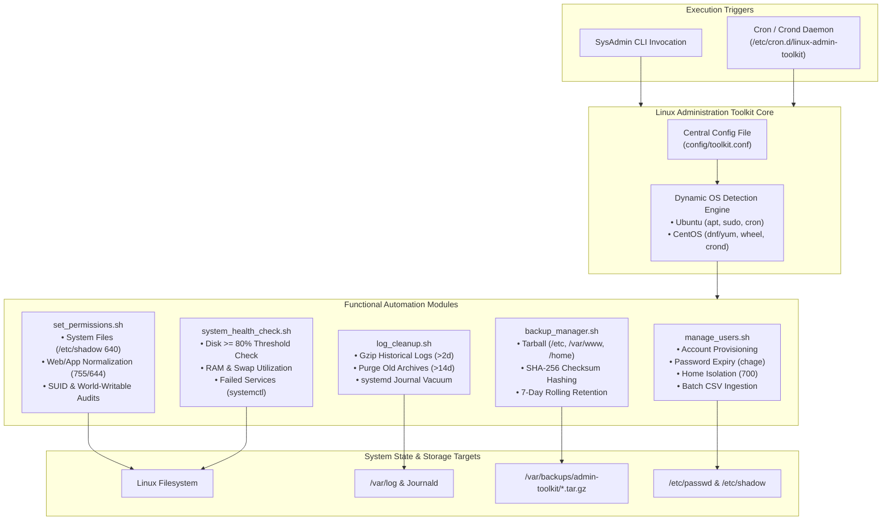

# Linux Administration & Automation Toolkit

[](https://www.kernel.org/)
[](https://www.gnu.org/software/bash/)
[](https://man7.org/linux/man-pages/man5/crontab.5.html)
[](https://www.cisecurity.org/cis-benchmarks)
[](https://en.wikipedia.org/wiki/SHA-2)
[](https://opensource.org/licenses/MIT)

An enterprise-ready suite of modular Bash automation scripts engineered to standardize, harden, and automate day-to-day Linux systems engineering operations. The toolkit encompasses automated user and group lifecycle provisioning, security permission auditing and hardening, automated log rotation with systemd journal vacuuming, and scheduled disaster-recovery backups featuring cryptographic SHA-256 integrity validation.

Engineered with cross-distribution parity, fully tested and certified across **Ubuntu (Debian family)** and **CentOS / RHEL / Rocky Linux (Red Hat family)**.

---

## Table of Contents

- [System Architecture & Workflow](#system-architecture--workflow)
- [Cross-Distribution OS Compatibility](#cross-distribution-os-compatibility)
- [Toolkit Directory Structure](#toolkit-directory-structure)
- [Script-by-Script Technical Reference](#script-by-script-technical-reference)
  - [1. User & Group Management (`manage_users.sh`)](#1-user--group-management-manage_userssh)
  - [2. Permissions Hardening & Security Audit (`set_permissions.sh`)](#2-permissions-hardening--security-audit-set_permissionssh)
  - [3. Automated Log Cleanup & Vacuum (`log_cleanup.sh`)](#3-automated-log-cleanup--vacuum-log_cleanupsh)
  - [4. Backup Automation & Integrity Verification (`backup_manager.sh`)](#4-backup-automation--integrity-verification-backup_managersh)
  - [5. System Health & Performance Audit (`system_health_check.sh`)](#5-system-health--performance-audit-system_health_checksh)
- [Automated Scheduling via Cron Daemon](#automated-scheduling-via-cron-daemon)
- [Centralized Configuration (`toolkit.conf`)](#centralized-configuration-toolkitconf)
- [Disaster Recovery & Restore Runbook](#disaster-recovery--restore-runbook)
- [Testing & Quality Assurance](#testing--quality-assurance)
- [Security & Compliance Standards](#security--compliance-standards)
- [License](#license)

---

## System Architecture & Workflow



---

## Cross-Distribution OS Compatibility

Linux distributions exhibit differences in package naming, default administrative groups, and cron daemon services. This toolkit abstracts these variances through automated dynamic runtime detection:

| Operational Dimension | Ubuntu / Debian Systems | CentOS / RHEL / Rocky / AlmaLinux | Toolkit Automation Handling |
| :--- | :--- | :--- | :--- |
| **OS Identifier** | `/etc/os-release` (`ID="ubuntu"`) | `/etc/os-release` (`ID="centos"`) | Parsed via `source /etc/os-release` |
| **Administrative Group** | `sudo` | `wheel` | Auto-detected and dynamically assigned |
| **Cron Service Daemon** | `cron` (`systemctl status cron`) | `crond` (`systemctl status crond`) | Auto-probed, enabled, and started |
| **Shadow Group Ownership** | `root:shadow` | `root:root` | Fallback logic sets appropriate group |
| **Package Managers** | `apt-get` / `dpkg` | `dnf` / `yum` / `rpm` | Toolkit scripts rely exclusively on native POSIX & coreutils |

---

## Toolkit Directory Structure

```
linux-admin-automation-toolkit/
├── config/
│   └── toolkit.conf             # Global settings (retention days, backup paths, alert thresholds)
├── cron/
│   ├── crontab_template         # Production cron job definitions
│   └── install_cron.sh          # One-click installer deploying to /etc/cron.d/
├── examples/
│   └── users.csv                # Sample batch CSV user import file
├── scripts/
│   ├── backup_manager.sh        # Automated compressed backup with SHA-256 checksums
│   ├── log_cleanup.sh           # Log rotation, gzip compression, and journal vacuuming
│   ├── manage_users.sh          # User/group provisioning and password lifecycle management
│   ├── set_permissions.sh       # File permissions hardening and SUID security audits
│   └── system_health_check.sh   # Live CPU, memory, disk, and failed service inspector
├── tests/
│   └── test_syntax.sh           # Bash syntax validation and linter script
├── .gitignore
└── README.md
```

---

## Script-by-Script Technical Reference

### 1. User & Group Management (`manage_users.sh`)

Automates single and batch user provisioning, group creation, and access locking according to security standards.

#### Key Capabilities:
- **Least-Privilege Home Directories**: Enforces `chmod 700 /home/<user>` so non-root users cannot browse or read neighbor directories.
- **Randomized Initial Passwords**: Generates cryptographically strong 12-character passwords using `openssl rand -base64 12`.
- **Enforced Password Expiry**: Invokes `chage -d 0 <user>` requiring the user to change their temporary password upon their first interactive login.
- **Home Directory Archiving on Deletion**: When deleting accounts (`--backup-home`), archives the user's home directory into `/var/backups/deleted_users/` before terminating processes and deleting files.

#### CLI Command Reference:

```bash
# Add a standard user with a secondary group
sudo ./scripts/manage_users.sh --add-user alice --group developers

# Add an administrative user (automatically selects 'sudo' on Ubuntu or 'wheel' on CentOS)
sudo ./scripts/manage_users.sh --add-user bob --sudo

# Delete a user and archive their home directory
sudo ./scripts/manage_users.sh --del-user charlie --backup-home

# Lock a compromised account immediately (disables password login)
sudo ./scripts/manage_users.sh --lock-user compromised_user

# Unlock an account
sudo ./scripts/manage_users.sh --unlock-user compromised_user

# Batch user provisioning via CSV
sudo ./scripts/manage_users.sh --batch examples/users.csv
```

#### CSV Batch File Format (`examples/users.csv`):
```csv
# username,secondary_group,is_sudo
dev_alice,developers,true
dev_bob,developers,false
qa_carol,testers,false
ops_dave,sysadmin,true
```

---

### 2. Permissions Hardening & Security Audit (`set_permissions.sh`)

Eliminates configuration drift and permission creep by aligning file permissions with the Center for Internet Security (CIS) Linux Benchmarks.

#### System Files Hardening Matrix:

| Target File | Enforced Mode | Enforced Ownership | Security Risk Mitigated |
| :--- | :--- | :--- | :--- |
| `/etc/passwd` | `0644` (`rw-r--r--`) | `root:root` | Prevents unauthorized modification of user accounts and shells |
| `/etc/shadow` | `0640` (`rw-r-----`) | `root:shadow` or `root:root` | Prevents non-privileged users from reading password hashes |
| `/etc/group` | `0644` (`rw-r--r--`) | `root:root` | Prevents unauthorized modification of group memberships |
| `/etc/gshadow`| `0640` (`rw-r-----`) | `root:shadow` or `root:root` | Prevents exposure of group passwords |
| `/etc/sudoers`| `0440` (`r--r-----`) | `root:root` | Prevents non-root modification of privilege escalation rules |
| `/home/*` | `0700` (`rwx------`) | `<user>:<user>` | Isolates user environments from cross-tenant snooping |

#### CLI Command Reference:

```bash
# Apply hardening to core operating system configuration files
sudo ./scripts/set_permissions.sh --harden-system

# Standardize permissions recursively across application or web directories
# (Directories set to 755, regular files set to 644)
sudo ./scripts/set_permissions.sh --fix-path /var/www/html --user www-data --group www-data

# Perform an interactive security audit
sudo ./scripts/set_permissions.sh --audit
```

The `--audit` flag executes non-destructive scans identifying:
1. **World-Writable Files**: Files with `chmod -0002` outside `/proc` and `/sys`.
2. **SUID Executables**: Executables with `chmod -4000` (SetUID) that could permit privilege escalation.
3. **Core Permissions Check**: Quick status printout of `/etc/shadow` and `/etc/sudoers`.

---

### 3. Automated Log Cleanup & Vacuum (`log_cleanup.sh`)

Prevents server outages caused by full `/var` disk partitions by rotating, compressing, and pruning system and application logs.

#### Execution Stages:
1. **Log Compression**: Identifies rotated, uncompressed log files older than 2 days (`*.log.1`, `*-[0-9]*`) and compresses them using `gzip -9` to reduce disk footprint by up to 85%.
2. **Retention Pruning**: Searches for compressed archives (`*.gz`, `*.xz`, `*.old`) older than the retention threshold (default: 14 days) and removes them.
3. **Journald Vacuuming**: Invokes `journalctl --vacuum-time=<N>d` to trim the binary systemd journal storage.
4. **Capacity Audit**: Calculates disk space before and after execution to report reclaimed capacity.

#### CLI Command Reference:

```bash
# Execute standard cleanup with default 14-day retention
sudo ./scripts/log_cleanup.sh

# Target a specific custom application log directory with 30-day retention
sudo ./scripts/log_cleanup.sh --target /var/log/my-app --days 30

# Dry-run mode (lists files that would be compressed or removed without deleting anything)
sudo ./scripts/log_cleanup.sh --dry-run
```

---

### 4. Backup Automation & Integrity Verification (`backup_manager.sh`)

Generates standalone, compressed disaster-recovery archives of mission-critical system configurations and application state.

#### Key Capabilities:
- **Timestamped Packaging**: Names archives using format `backup_<HOSTNAME>_<YYYYMMDD_HHMMSS>.tar.gz`.
- **Cryptographic Hashing**: Simultaneously generates a SHA-256 hash stored in `backup_<...>.tar.gz.sha256` for tamper and corruption detection.
- **Rolling Retention**: Automatically identifies and deletes local backup archives older than the retention threshold (default: 7 days).

#### CLI Command Reference:

```bash
# Execute backup using paths defined in config/toolkit.conf
sudo ./scripts/backup_manager.sh

# Run ad-hoc backup specifying custom directories, destination, and retention
sudo ./scripts/backup_manager.sh --sources "/etc,/var/www,/home" --dest /mnt/backup_drive --retention 14
```

---

### 5. System Health & Performance Audit (`system_health_check.sh`)

Provides a quick diagnostic summary of system health across CPU, memory, storage, and service reliability.

#### Health Check Metrics:
1. **Disk Partition Saturation**: Flags any filesystem partition with utilization $\ge 80\%$.
2. **RAM & Swap Consumption**: Computes exact percentage of physical RAM and swap utilized.
3. **System Load Average**: Prints 1-minute, 5-minute, and 15-minute kernel load averages.
4. **Top Resource Consumers**: Lists the top 5 CPU-intensive and top 5 memory-intensive processes.
5. **Systemd Service Health**: Queries `systemctl --failed` to surface crashed daemons.

```bash
sudo ./scripts/system_health_check.sh
```

---

## Automated Scheduling via Cron Daemon

The toolkit provides an automated installer [`cron/install_cron.sh`](cron/install_cron.sh) that packages the scripts into `/opt/linux-toolkit/` and deploys a system-level configuration into `/etc/cron.d/linux-admin-toolkit`.

### Deploying the Automated Schedule

```bash
sudo chmod +x cron/install_cron.sh
sudo ./cron/install_cron.sh
```

### Registered Crontab Schedule

| Timing | Schedule | Executed Script | Log Output Target |
| :--- | :--- | :--- | :--- |
| **Every Sunday at 02:00 AM** | `0 2 * * 0` | `log_cleanup.sh --days 14` | `/var/log/admin-toolkit-cleanup.log` |
| **Every Day at 03:00 AM** | `0 3 * * *` | `backup_manager.sh` | `/var/log/admin-toolkit-backup.log` |
| **Every Monday at 04:00 AM** | `0 4 * * 1` | `set_permissions.sh --audit`| `/var/log/admin-toolkit-audit.log` |

---

## Centralized Configuration (`toolkit.conf`)

Settings can be customized without editing Bash code by modifying [`config/toolkit.conf`](config/toolkit.conf):

```bash
# Source directories to include in routine backups
BACKUP_SOURCE_DIRS=("/etc" "/var/www" "/home")

# Backup storage destination
BACKUP_DEST_DIR="/var/backups/admin-toolkit"

# Number of days to retain daily backup archives
BACKUP_RETENTION_DAYS=7

# Log cleanup target directories and retention window
LOG_CLEANUP_TARGETS=("/var/log")
LOG_RETENTION_DAYS=14
VACUUM_JOURNAL_DAYS=14

# Permissions baseline
DEFAULT_DIR_PERMS="755"
DEFAULT_FILE_PERMS="644"
SECURE_HOME_PERMS="700"
```

---

## Disaster Recovery & Restore Runbook

In the event of hardware failure, misconfiguration, or corruption, follow this restoration procedure:

### 1. Verify Backup Integrity via SHA-256 Checksum
```bash
cd /var/backups/admin-toolkit

# Validate the archive matches its generated checksum
sha256sum -c backup_server01_20261105_030000.tar.gz.sha256
```
*Expected Output:*
```text
backup_server01_20261105_030000.tar.gz: OK
```

### 2. Inspect Archive Contents Before Restoring
```bash
tar -ztvf backup_server01_20261105_030000.tar.gz | head -n 30
```

### 3. Extract Archive to Root or Staging Directory
```bash
# To extract to a temporary inspection directory:
mkdir -p /tmp/restore_check
tar -zxvf backup_server01_20261105_030000.tar.gz -C /tmp/restore_check

# Or restore directly to filesystem root (use with caution):
sudo tar -zxvf backup_server01_20261105_030000.tar.gz -C /
```

---

## Testing & Quality Assurance

All scripts include strict error-handling directives (`set -euo pipefail`). To validate script syntax across the toolkit before deploying:

```bash
chmod +x tests/test_syntax.sh
./tests/test_syntax.sh
```

Sample output:
```text
=== Running Bash Syntax Validation ===
Checking backup_manager.sh... [OK]
Checking log_cleanup.sh... [OK]
Checking manage_users.sh... [OK]
Checking set_permissions.sh... [OK]
Checking system_health_check.sh... [OK]
Checking install_cron.sh... [OK]
All scripts passed syntax validation!
```

---

## Security & Compliance Standards

The implementations in this repository follow industry guidelines:
- **CIS Linux Benchmark 1.1**: Strict file permissions on critical system auth files.
- **CIS Linux Benchmark 5.2**: Password aging and temporary credential reset.
- **NIST SP 800-88**: Secure data handling and archival before account removal.

---

## License

This project is licensed under the terms of the [MIT License](LICENSE). Copyright &copy; 2026 Gaurav Khaladkar.


